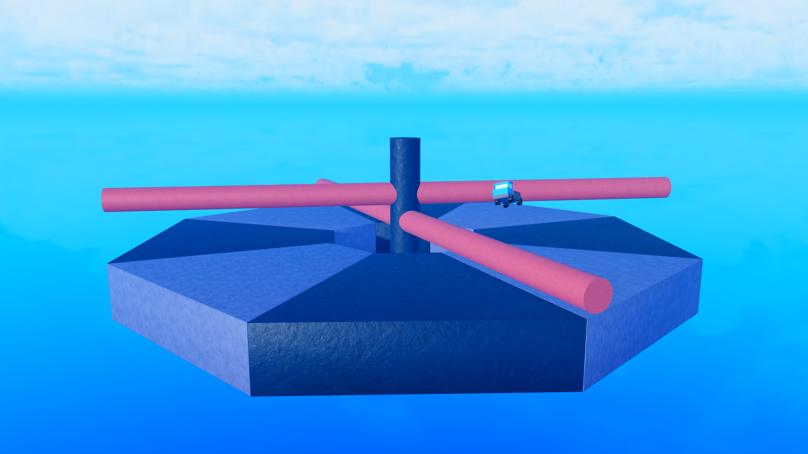

# Parkar
A game on Roblox with car physics and aerial vehicle controls, alongside a fun little minigame.

The difficulty ramps up as platforms start to disappear.

---


## Features
- Spinner minigame
- Boost mechanics that allow for maneuverability in the air
- Game difficulty that increases over time

## Trying it Yourself
You can play it on the Roblox website using this link [here](https://www.roblox.com/games/74791023478675/Parkar) or by downloading it from Releases.

Once downloaded, the game file can be ran via Roblox Studio.
> Note that only playing on PC is supported for now

## Game Controls
```
WASD - Car controls, on the ground and in the air
Q/E - Roll the car left or right
Space/Right Mouse - Jump
Left Shift/Left Mouse - Boost
Left Ctrl - Camera lock
```

## License
Parkar is released under the MIT License.